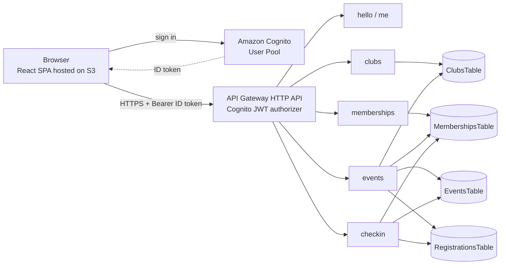

# ClubOS

ClubOS is a serverless web application for managing college clubs. Students browse clubs and request to join, club executives approve members and run events, members register for events and receive a QR ticket, and executives check attendees in at the door. Everything runs on AWS serverless services and fits inside the free tier for a demo.

- **Frontend:** React single-page app, hosted as a static website on Amazon S3
- **Backend:** Python Lambda functions behind an API Gateway HTTP API, deployed with AWS SAM
- **Auth:** Amazon Cognito (JWT authorizer on every route except `GET /hello`)
- **Data:** Amazon DynamoDB (on-demand)

---

## Table of contents

1. [Features](#features)
2. [Architecture](#architecture)
3. [Tech stack](#tech-stack)
4. [Roles and permissions](#roles-and-permissions)
5. [Project structure](#project-structure)
6. [Data model](#data-model)
7. [API reference](#api-reference)
8. [Key design decisions](#key-design-decisions)
9. [Getting started](#getting-started)
10. [Deploying the frontend (S3)](#deploying-the-frontend-s3)
11. [Testing](#testing)
12. [Demo data and demo script](#demo-data-and-demo-script)
13. [Security notes](#security-notes)
14. [Known limitations and scope](#known-limitations-and-scope)
15. [Cost and cleanup](#cost-and-cleanup)

---

## Features

**Accounts and roles**
- Email and password sign-in with Amazon Cognito
- Two global roles from Cognito groups: `student` and `college_admin`
- Per-club roles stored in DynamoDB: `member` and `executive`
- Role-based navigation and route guards in the UI; the backend re-checks every permission

**Clubs**
- Browse all active clubs, with your membership status shown on each card
- Request to join a club; the request starts as `pending`
- Executives and admins approve or reject requests
- Admins promote an approved member to executive
- Admins create clubs from the Admin dashboard
- Admins delete a club from the club page (confirmation prompt, soft delete, see [Key design decisions](#key-design-decisions))

**Events and registration**
- Executives and admins create events with a venue, start time, registration deadline and capacity
- Approved members register for events and cancel their registration
- Live "spots left" count on every event
- Capacity, registration deadline and duplicate registration are enforced on the server

**Tickets and check-in**
- Each registration gets an opaque, random ticket ID, shown as a QR code
- Executives and admins check attendees in by entering the ticket ID
- A ticket works exactly once; a second scan is rejected
- Attendance list with checked-in counts
- A checked-in attendee can no longer cancel

**Dashboards**
- User dashboard: your memberships and your event registrations
- Admin dashboard: create clubs

---

## Architecture



**Request flow**
1. The browser signs in by calling the Cognito `InitiateAuth` API (`USER_PASSWORD_AUTH`) and receives an ID token.
2. Every API call sends `Authorization: Bearer <ID token>`.
3. API Gateway validates the token with the Cognito JWT authorizer, then invokes the Lambda that owns the route.
4. Each Lambda reads the caller's identity and groups from the validated token claims, applies its own authorization rules, and reads or writes DynamoDB.

One Lambda per feature area. Each Lambda file is self-contained and routes on `event["routeKey"]`.

---

## Tech stack

| Layer | Technology |
|---|---|
| Frontend | React 19, TypeScript, Vite, Tailwind CSS v4, react-router-dom v7, lucide-react, qrcode.react |
| API | Amazon API Gateway (HTTP API) with Cognito JWT authorizer and CORS |
| Compute | AWS Lambda, Python 3.13, boto3 |
| Auth | Amazon Cognito User Pool (groups: `student`, `college_admin`) |
| Database | Amazon DynamoDB, on-demand billing, global secondary indexes |
| Infrastructure as code | AWS SAM (CloudFormation) |
| Hosting | Amazon S3 static website hosting |
| Scripts | PowerShell (deploy, seed, acceptance tests) |

Region used throughout: `ap-south-1`.

---

## Roles and permissions

| Action | Student (not in club) | Member (approved) | Executive (of that club) | College admin |
|---|:-:|:-:|:-:|:-:|
| Browse clubs and events | Yes | Yes | Yes | Yes |
| Request to join a club | Yes | n/a | n/a | Not offered in the UI |
| Register for / cancel an event | No | Yes | Yes | No |
| View own ticket | If registered | If registered | If registered | If registered |
| Approve or reject join requests | No | No | Yes | Yes |
| Create events | No | No | Yes | Yes |
| Check in attendees, view attendance | No | No | Yes | Yes |
| Promote a member to executive | No | No | No | Yes |
| Create a club | No | No | No | Yes |
| Delete a club | No | No | No | Yes |

Global roles (`college_admin`) come from Cognito groups in the token. Per-club roles are looked up in DynamoDB on every request, so a role change takes effect immediately without re-login.

---

## Project structure

```
ClubOS/
├── backend/
│   ├── template.yaml          # SAM template: Cognito, API, tables, Lambdas, policies, CORS
│   ├── samconfig.toml         # SAM deploy settings
│   └── src/
│       ├── hello/             # GET /hello (public health check)
│       ├── me/                # GET /me
│       ├── clubs/             # create, list, get, delete clubs
│       ├── memberships/       # join, list members, approve/reject, my memberships
│       ├── events/            # events, registration, my registrations
│       └── checkin/           # tickets, check-in, attendance
├── frontend/
│   ├── .env.example           # required environment variables
│   └── src/
│       ├── components/        # auth guards, clubs, events, layout, ui
│       ├── context/           # AuthProvider and context
│       ├── hooks/             # useAuth, useLoad
│       ├── lib/               # config, roles, styles, formatting
│       ├── pages/             # Home, auth, user, admin, clubs, events
│       ├── services/          # API client, Cognito, session, clubs, events
│       └── types/             # shared TypeScript types
├── deploy/
│   ├── setup-hosting.ps1      # one-time S3 website bucket setup
│   └── deploy-frontend.ps1    # build and upload the frontend
├── scripts/
│   └── seed-demo.ps1          # creates demo clubs, members, events, registrations
├── tests/                     # PowerShell acceptance tests
└── docs/
    └── demo-script.md         # step-by-step demo walkthrough
```

### Frontend routes

| Route | Access | Page |
|---|---|---|
| `/` | Public | Home |
| `/login` | Public | Sign in |
| `/user` | Signed in | My memberships and registrations |
| `/admin` | College admin | Create clubs |
| `/clubs` | Signed in | Browse clubs |
| `/clubs/:clubId` | Signed in | Club detail, events, members panel, delete (admin) |
| `/clubs/:clubId/events/:eventId` | Signed in | Event detail, register, ticket QR, check-in and attendance (exec/admin) |

---

## Data model

Single fixed college: the server decides the tenant from the `COLLEGE_ID` environment variable (`demo-college`). The client never sends a college ID.

### ClubsTable
- Key: partition `collegeId`, sort `clubId` (UUID)
- Attributes: `name`, `description`, `category`, `status` (`active` or `inactive`), `createdBy`, `createdAt`, and `deletedAt` / `deletedBy` once deleted

### MembershipsTable
- Key: partition `clubId`, sort `userId` (Cognito `sub`)
- Attributes: `collegeId`, `email`, `role` (`member` or `executive`), `status` (`pending`, `approved`, `rejected`), `requestedAt`, `updatedAt`
- GSI `UserClubsIndex`: partition `userId`, sort `clubId` (used for "my memberships")

### EventsTable
- Key: partition `clubId`, sort `eventId` (UUID)
- Attributes: `collegeId`, `title`, `description`, `venue`, `startsAt`, `registrationDeadline` (ISO 8601, UTC), `capacity`, `registeredCount`, `status` (`published`), `createdBy`, `createdAt`

### RegistrationsTable
- Key: partition `eventId`, sort `userId`
- Attributes: `clubId`, `collegeId`, `email`, `status` (`registered` or `checked_in`), `ticketId`, `registeredAt`, `checkedInAt`, `checkedInBy`
- GSI `UserRegistrationsIndex`: partition `userId`, sort `eventId` (used for "my registrations")
- GSI `TicketIndex`: partition `ticketId` (used for check-in lookup)

---

## API reference

All routes require `Authorization: Bearer <Cognito ID token>` except `GET /hello`. Error bodies are JSON with a message. Common status codes: `400` validation, `401` missing or invalid token, `403` not allowed, `404` not found, `409` conflict (duplicate, full, closed, already used).

| Method and path | Who | Description |
|---|---|---|
| `GET /hello` | Public | Health check |
| `GET /me` | Signed in | Returns `userId`, `email`, `groups` |
| `POST /clubs` | Admin | Create a club (`name` required, max 100 chars; `description` max 500; `category` max 50) |
| `GET /clubs` | Signed in | List active clubs, sorted by name |
| `GET /clubs/{clubId}` | Signed in | Get one active club |
| `DELETE /clubs/{clubId}` | Admin | Soft-delete a club (marks it `inactive`) |
| `POST /clubs/{clubId}/join` | Signed in | Request to join; creates a `pending` membership; `409` if one exists |
| `GET /clubs/{clubId}/members?status=` | Executive, admin | List members, filtered by status |
| `PATCH /clubs/{clubId}/members/{userId}` | Executive, admin | Approve or reject (`status`); role changes are admin only (`role`) |
| `GET /me/memberships` | Signed in | Your memberships across clubs |
| `POST /clubs/{clubId}/events` | Executive, admin | Create an event |
| `GET /clubs/{clubId}/events` | Signed in | List a club's events, sorted by start time |
| `GET /clubs/{clubId}/events/{eventId}` | Signed in | Get one event (includes `spotsLeft`) |
| `POST /clubs/{clubId}/events/{eventId}/register` | Approved member | Register; returns the registration with its `ticketId` |
| `DELETE /clubs/{clubId}/events/{eventId}/register` | Registrant | Cancel; blocked once checked in |
| `GET /me/registrations` | Signed in | Your registrations across events |
| `GET /clubs/{clubId}/events/{eventId}/ticket` | Registrant | Your ticket ID and status |
| `POST /clubs/{clubId}/events/{eventId}/checkin` | Executive, admin | Body `{"ticketId": "..."}`; marks the attendee checked in |
| `GET /clubs/{clubId}/events/{eventId}/attendance` | Executive, admin | Registrations with totals; never returns ticket IDs |

### Event creation rules
- `title` required (max 100), `venue` required (max 200), `description` optional (max 2000)
- `capacity` an integer from 1 to 10000
- `startsAt` and `registrationDeadline` are ISO 8601 with a timezone
- The deadline must not be after the start time

### Registration rules
- Caller must be an approved member of the club
- The event must be `published` and the deadline must not have passed (`409` otherwise)
- Registering twice returns `409`; a full event returns `409`

---

## Key design decisions

- **Server-side tenant.** One fixed college, set by `COLLEGE_ID`. The college stays in the Clubs key for future multi-college support, but clients cannot choose it.
- **Two layers of roles.** Global role (`college_admin`) from Cognito groups; per-club role (`member`, `executive`) from DynamoDB, checked on every request.
- **Atomic registration.** Registering is one DynamoDB transaction: put the registration (fails if one already exists) and increment `registeredCount` on the event (fails if the event is full or not published). Two people cannot take the last seat at the same time.
- **Atomic cancellation.** Cancelling deletes the registration only if it is still `registered` and decrements the counter in the same transaction.
- **Single-use tickets.** Check-in is a conditional update from `registered` to `checked_in`. A second scan fails with `409` even if two scanners race.
- **Opaque ticket IDs.** Tickets are random URL-safe tokens generated with Python's `secrets` module, not derived from user or event data. The QR code is generated in the browser from the ticket ID.
- **Soft delete for clubs.** Deleting a club sets `status` to `inactive` and records `deletedAt` and `deletedBy`. The club disappears from lists and returns `404` when fetched directly. Only the club record changes; its memberships, events and registrations are left in place.
- **Least-privilege IAM.** Each Lambda gets only the SAM policy templates it needs (read-only or CRUD, per table).
- **No SDK on the frontend.** Sign-in is a plain `fetch` to the Cognito API; no auth library is needed.

---

## Getting started

### Prerequisites
- An AWS account and the AWS CLI configured with credentials that can create the resources below
- AWS SAM CLI
- Python 3.13 (SAM builds the Lambdas; match the runtime in the template)
- Node.js (a current LTS release) and npm
- PowerShell (the scripts are written for Windows PowerShell or PowerShell 7)

### 1. Deploy the backend

```powershell
cd backend
sam validate
sam build
sam deploy --guided      # first time; choose region ap-south-1 and a stack name
```

Subsequent deploys: `sam build` then `sam deploy`.

Note the stack outputs: `ApiUrl`, `UserPoolId`, `UserPoolClientId`. The stack creates the Cognito user pool, app client, the `student` and `college_admin` groups, the HTTP API, four DynamoDB tables and six Lambda functions.

### 2. Create users

Replace `<UserPoolId>` with your value. Repeat for each user; add the group that matches the role.

```powershell
aws cognito-idp admin-create-user --user-pool-id <UserPoolId> --username admin@example.com --user-attributes Name=email,Value=admin@example.com Name=email_verified,Value=true --message-action SUPPRESS --region ap-south-1
aws cognito-idp admin-set-user-password --user-pool-id <UserPoolId> --username admin@example.com --password "Admin1234" --permanent --region ap-south-1
aws cognito-idp admin-add-user-to-group --user-pool-id <UserPoolId> --username admin@example.com --group-name college_admin --region ap-south-1
```

For students, use the group `student`.

### 3. Run the frontend locally

```powershell
cd frontend
copy .env.example .env.local
```

Edit `.env.local`:

```
VITE_API_URL=<ApiUrl>
VITE_COGNITO_REGION=ap-south-1
VITE_COGNITO_CLIENT_ID=<UserPoolClientId>
```

Then:

```powershell
npm install
npm run dev
```

Open `http://localhost:5173`. That origin is allowed by the API's CORS configuration in `backend/template.yaml`. If you run on a different port or host, add it to `CorsConfiguration.AllowOrigins` and redeploy.

### 4. Build and lint

```powershell
cd frontend
npm run lint
npm run build
```

---

## Deploying the frontend (S3)

The frontend is hosted as a public S3 static website (HTTP only; CloudFront is not used).

1. **One-time bucket setup** (creates `clubos-frontend-<accountId>`, public-read policy, website hosting with `index.html` as the error document so deep links work):
   ```powershell
   powershell -ExecutionPolicy Bypass -File deploy/setup-hosting.ps1
   ```
   It prints the site URL: `http://clubos-frontend-<accountId>.s3-website.ap-south-1.amazonaws.com`.
2. **Allow the site in CORS.** Add that URL to `CorsConfiguration.AllowOrigins` in `backend/template.yaml` (keep `http://localhost:5173`), then `sam build` and `sam deploy`.
3. **Publish the frontend:**
   ```powershell
   powershell -ExecutionPolicy Bypass -File deploy/deploy-frontend.ps1
   ```
   Re-run this script after every frontend change.

If the bucket policy is rejected, account-level S3 Block Public Access is enabled. That setting must be turned off for a public website bucket.

---

## Testing

The acceptance tests are PowerShell scripts in `tests/`. They call the deployed API and print `PASS` or `FAIL` per check.

| Script | Covers |
|---|---|
| `tests/step6.ps1` | Event registration, capacity, duplicates, cancel, tickets, check-in, duplicate scan, attendance, authorization |
| `tests/step7a.ps1` | CORS preflight, `/me` response shape, Cognito sign-in from a browser origin, 401 without token |
| `tests/step7e.ps1` | Hosted site, deep-link routing, CORS for the site origin |

Run from the repository root:

```powershell
powershell -ExecutionPolicy Bypass -File tests/step6.ps1
```

The scripts contain the API URL, Cognito client ID and the demo users at the top. Update those values if you deploy your own stack.

Quick health checks:

```powershell
aws cloudformation describe-stacks --stack-name <your-stack-name> --region ap-south-1 --query "Stacks[0].StackStatus" --output text
aws logs tail /aws/lambda/<function-name> --since 1h --filter-pattern ERROR --region ap-south-1
```

---

## Demo data and demo script

Seed a fresh demo dataset (3 clubs, members at different statuses, a pending join request, 3 events, some registrations):

```powershell
powershell -ExecutionPolicy Bypass -File scripts/seed-demo.ps1
```

The script creates new clubs on every run. It expects these demo accounts to exist (see [Create users](#2-create-users)):

| Account | Password | Role |
|---|---|---|
| `admin@example.com` | `Admin1234` | `college_admin` |
| `exec1@example.com` | `Student1234` | `student` (made club executive by the seed) |
| `member1@example.com` | `Student1234` | `student` |
| `student2@example.com` | `Student1234` | `student` |
| `student3@example.com` | `Student1234` | `student` |
| `test@example.com` | `Student1234` | `student` |

These are throwaway accounts for the demo deployment only. Delete them (or the whole stack) when you are done.

A step-by-step walkthrough for presenting the app is in [`docs/demo-script.md`](docs/demo-script.md). To stay signed in as several users at once, use separate browser profiles or an incognito window, because the session is stored in the browser's local storage.

---

## Security notes

- Every route except `GET /hello` sits behind the Cognito JWT authorizer; invalid or missing tokens get `401` from API Gateway.
- Authorization is enforced in the Lambdas, not only in the UI. Hiding a button is never the only protection.
- Tenant selection is server-side; request bodies cannot override the college.
- Ticket IDs are random and unguessable, and the attendance endpoint never returns them.
- The ID token is stored in the browser's local storage for the session. This is simple, but a cross-site scripting bug would expose it. There is no refresh-token flow; when the token expires the user is sent back to sign in.
- The S3 website is served over HTTP. Use CloudFront with HTTPS for anything beyond a demo.
- Test credentials in this repository are for a throwaway demo deployment. Do not reuse them anywhere real.

---

## Known limitations and scope

**Known limitations**
- Deleting a club is a soft delete with no cascade. Its memberships, events and registrations remain in DynamoDB, so views that list a user's memberships or registrations can still include records for a deleted club.
- No pagination on member, event and registration lists (fine at demo scale).
- Check-in is by entering the ticket ID. A camera QR scanner needs HTTPS, which the S3 website endpoint does not provide.
- Single college only.
- Session expires with the Cognito ID token (about an hour); there is no silent refresh.
- Newly created Cognito users that must change their password at first sign-in are not supported; create users with a permanent password.

**Out of scope for this version**
- Interview and recruitment workflow, tasks, announcements, documents, analytics, finance
- Notifications with SQS or SNS
- CloudFront and a custom domain
- CI/CD pipeline
- Faculty advisor role
- Multi-college tenancy

---

## Cost and cleanup

The stack is pay-per-use: DynamoDB on-demand, Lambda, API Gateway, Cognito and a small S3 bucket stay within the AWS free tier for demo traffic.

To remove everything:

```powershell
$acct = aws sts get-caller-identity --query Account --output text
aws s3 rm "s3://clubos-frontend-$acct" --recursive
aws s3 rb "s3://clubos-frontend-$acct"
cd backend
sam delete --stack-name <your-stack-name> --region ap-south-1
```
